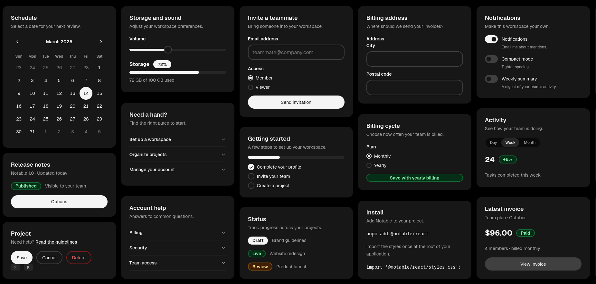

# One

**Expressive, accessible components with thoughtful details and a cohesive design language.**

One is a component library built for React, designed around a cohesive and expressive design language. It brings together thoughtful visual foundations, design principles, interaction patterns, and production-ready components.

One balances personality with precision, combining expressive visuals, purposeful motion, and robust accessibility to create experiences that feel natural and consistent.

## Contents

- [Vision](#vision)
- [Design language](#design-language)
- [Installation](#installation)
- [Guidelines](#guidelines)
- [Components](#components)
- [License](#license)

## Vision

Interfaces should be more than functional. They should feel considered.

One aims to make everyday interactions clearer, more natural, and more expressive. Every detail should contribute to a cohesive experience, from the shape of a surface to the movement of an interaction.

## Design language

One is built around four dimensions:

- **Foundations** — Color, typography, spacing, shape, elevation, focus, and motion.
- **Components** — Accessible components built for React, with consistent visuals and behavior.
- **Patterns** — Shared approaches to interaction, selection, loading, and interface states.
- **Principles** — The ideas that guide design decisions and preserve the system's identity.

## Installation

```sh
npm install @one/components
```

## Guidelines

Explore the [design guidelines](./docs/guidelines/README.md) for the foundations, patterns, principles, and conventions that define One.

- [Foundations](./docs/guidelines/foundations/README.md)
- [Components](./docs/guidelines/components/README.md)
- [Patterns](./docs/guidelines/patterns/README.md)
- [Principles](./docs/guidelines/principles/README.md)

## Preview



## Components

The component library is located in [`packages/components`](./packages/components).

## License

One is available under the [MIT License](./LICENSE).
